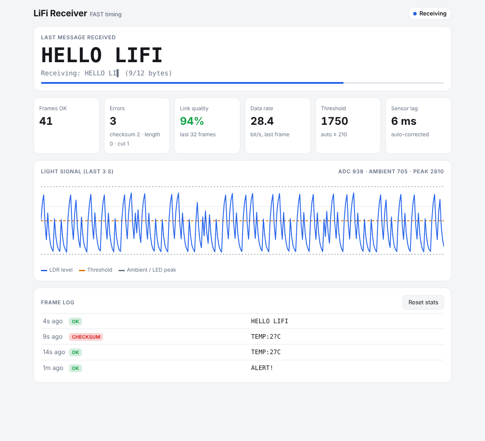

# LiFi Receiver — ESP32

This sketch decodes the light pulses from the Arduino Nano transmitter. When a frame passes the checksum it chirps the buzzer, and it shows everything on a live web dashboard served over the ESP32's own Wi-Fi.

## 1. Parts

| Qty | Part | Purpose |
|-----|------|---------|
| 1 | ESP32 dev board (ESP32-WROOM DevKit) | Receiver + web server |
| 1 | LDR (GL5528 or similar) | Light sensor |
| 1 | 10 kΩ resistor | Voltage divider with the LDR |
| 1 | 10 kΩ potentiometer | Threshold calibration |
| 1 | Buzzer (active or passive) | Audio feedback |

## 2. Wiring

```
 3.3V ──── LDR ────┬──── 10kΩ ──── GND
                   │
                 GPIO36 (VP)          ← light level (brighter = higher voltage)

 3.3V ──┐
       POT ── wiper ── GPIO34         ← threshold knob
 GND  ──┘

 GPIO25 ── Buzzer (+)   Buzzer (−) ── GND
```

- Use **3.3V, not 5V**. ESP32 ADC pins must stay at or below 3.3 V.
- GPIO36 and GPIO34 are input-only ADC1 pins. They keep working while Wi-Fi is on. ADC2 pins don't.

## 3. Upload

1. In Arduino IDE, install the ESP32 board package: **Boards Manager → "esp32" by Espressif** (2.x or 3.x both work).
2. **Tools → Board → ESP32 Dev Module.**
3. Open `receiver_esp32.ino`. `LiFiDecoder.h` and `dashboard.h` must be in the same folder, and the IDE opens them as tabs.
4. Upload, then open **Serial Monitor at 115200 baud**.

No extra libraries are needed.

## 4. Open the dashboard

1. On your phone or laptop, join Wi-Fi **`LiFi-Receiver`**, password **`lifi1234`**.
2. Most phones open the dashboard automatically (captive portal). If not, browse to **http://192.168.4.1**.
3. Optional: to use your normal Wi-Fi instead, set `STA_SSID`/`STA_PASS` at the top of the sketch. Then open the IP printed in Serial Monitor, or **http://lifi.local**.



What the dashboard shows:
- **Last message**: the latest message that passed the checksum. It flashes green when a new one arrives.
- **Receiving**: the text decoding live, character by character, with a progress bar.
- **Light signal**: a 3-second scope of the LDR level, with the threshold (orange) and the ambient/peak levels (grey). Use it to tune the knob.
- **Stats**: frames OK, errors by type, link quality over the last 32 frames, data rate, threshold, and measured sensor lag.
- **Frame log**: the last 12 frames, including failed ones.

## 5. Calibration

The pot has two modes:

| Pot position | Mode |
|---|---|
| Fully counter-clockwise | **Auto**: the ESP32 tracks room light and LED brightness and puts the threshold halfway between them. Start here. |
| Anywhere else | **Manual**: the pot position *is* the threshold (0–4095). |

For manual tuning:
1. Point the LED at the LDR (2–10 cm) and watch the scope.
2. Turn the knob until the orange threshold line sits **halfway between the bottom of the trace (LED off) and the tops of the pulses**.
3. If the status says "Light detected" continuously, the threshold is too low: room light alone is crossing it.

## 6. How the decoding works

The decoding logic lives in `LiFiDecoder.h`, which is plain C++ and also runs in the `../tests` simulation.

1. **Sampling:** a FreeRTOS task on core 1, at higher priority than the web server, reads the LDR every 1 ms (4 samples averaged).
2. **Slicer:** compares the level against the threshold with **hysteresis**, so noise near the threshold doesn't cause false edges. In auto mode it keeps track of the ambient floor and the LED peak, reacting instantly to new extremes and drifting back slowly.
3. **Pulse measurement:** the decoder measures how long each ON pulse lasts:
   - < 3 ms → glitch, ignored
   - ≥ 55 ms → **preamble**: start of a new frame. The receiver also measures how much the LDR stretched it (actual − 80 ms). That stretch is subtracted from every following bit, because a slow LDR makes every pulse look longer.
   - Otherwise it's a bit: corrected width ≥ 20 ms → `1`, else `0`.
4. **Framing:** bits are assembled MSB-first into bytes. The first byte is LEN (1–32), then the payload, then the checksum.
5. **Validation:** XOR of LEN and the payload must equal the checksum. Otherwise the frame is logged as `checksum`. Other failures are `length` (impossible LEN) or `truncated` (light stopped for more than 70 ms mid-frame).

## 7. Timing profiles

Both boards must use the same profile.

| Profile | Preamble | `1` | `0` | Gap | Speed | Works with LDR fall time up to* |
|---|---|---|---|---|---|---|
| `FAST` (default, your spec) | 80 ms | 30 ms | 10 ms | 15 ms | ~29 bit/s | ~15 ms |
| `LDR_SAFE` | 240 ms | 100 ms | 30 ms | 50 ms | ~9 bit/s | ~40 ms |

\* From `tests/link_sim.cpp`, which models the LDR as a first-order lag.

To switch to `LDR_SAFE`:
- **Receiver:** uncomment `#define LIFI_PROFILE LIFI_PROFILE_LDR_SAFE` near the top of `receiver_esp32.ino`.
- **Transmitter:** uncomment `#define LIFI_TX_LDR_SAFE` near the top of `transmitter_nano.ino`.

The dashboard title shows which profile the receiver is running.

## 8. Troubleshooting

| Symptom | Fix |
|---|---|
| Status stays "No signal" | The LED isn't reaching the LDR. Align them, move closer, shade the LDR. In auto mode the difference between LED-on and LED-off must exceed ~250 ADC counts. |
| "Light detected" constantly | Room light is above the threshold. Shade the LDR with a tube, or turn the knob higher. |
| Many `checksum` / `length` errors | The LDR is too slow. Check the scope: if pulses never drop back to the floor between bits, switch both boards to `LDR_SAFE` or use a phototransistor. |
| Many `truncated` | The beam is being interrupted, or the threshold sits too close to the peak. Lower it. |
| Scope trace barely moves | Try a brighter LED or a darker room. A 10 k divider suits a GL5528. For a very dim setup, try 47 k. |
| Dashboard won't load | Some phones drop a Wi-Fi network that has no internet. Choose "stay connected", or turn off mobile data. |
| No sound | An active buzzer needs + on GPIO25. A passive one works with either orientation. |
