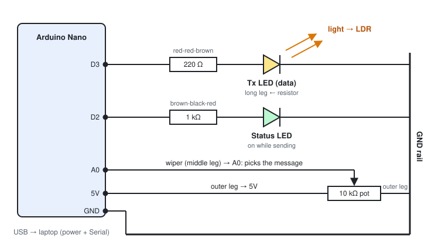

# LiFi Transmitter — Arduino Nano

This sketch sends text over a beam of light. It uses pulse-width On-Off Keying (OOK), and the ESP32 + LDR receiver decodes it.

## 1. Parts

| Qty | Part | Purpose |
|-----|------|---------|
| 1 | Arduino Nano | Transmitter MCU |
| 1 | Bright LED (white or red, 5 mm) | Optical Tx |
| 1 | 220 Ω resistor | Current limit for the Tx LED (~10–15 mA) |
| 1 | LED (any colour) + 1 kΩ resistor | Status: lights up while a frame is being sent |
| 1 | 10 kΩ potentiometer | Picks which message to send |
| — | Breadboard, jumpers, USB cable | |

## 2. Hardware setup



The transmitter is three small circuits, each starting at a Nano pin and ending on the shared GND rail:

| Circuit | Path | Job |
|---|---|---|
| Data LED | **D3 → 220 Ω → LED → GND** | Sends the light signal |
| Status LED | **D2 → 1 kΩ → LED → GND** | Lights while a frame is sent |
| Selector pot | **5V → pot → GND**, middle leg **→ A0** | Picks which message to send |

### 2.1 Identify your parts

- **LED polarity:** the **long leg is + (anode)**. The short leg, on the side with the flat edge of the rim, is − (cathode). A reversed LED does nothing, but it isn't damaged.
- **Resistor colour bands** (4-band, read from the end away from the gold band):
  - **220 Ω** = red, red, brown, gold
  - **1 kΩ** = brown, black, red, gold

  If unsure, check with a multimeter on Ω. Resistors have no polarity.
- **10 kΩ pot:** marked `103` or `B10K`. With the knob facing you and the legs pointing down, the legs are left, middle (wiper) and right.
- **Breadboard:**
  - In the middle area, each numbered **row of 5 holes (a–e or f–j) is connected**.
  - The centre gap separates the two halves.
  - The long **+ and − rails** along the edges run the full length. On some boards they're split in the middle, so bridge them with a jumper.

### 2.2 Build it step by step

**Unplug USB while wiring.**

1. **Place the Nano.** Push it in so it straddles the centre gap, with the USB connector at one end of the breadboard. Each Nano pin now has its own row with 4 free holes beside it.
   - The **D2/D3 side** reads, from the USB end: `D12 … D4, D3, D2, GND, RST, RX0, TX1`.
   - The **A0/5V side** reads: `D13, 3V3, REF, A0 … A7, 5V, RST, GND, VIN`.
2. **Power rails.**
   - Jumper from the Nano's **5V** row to the **+ rail**.
   - Jumper from a Nano **GND** row to the **− rail**.
3. **Data LED (D3).**
   - Put one end of the **220 Ω** resistor in the D3 row and the other end in an empty row, say row X.
   - Put the data LED's **long leg in row X**.
   - Put its **short leg into the − rail**.
   - Use the brightest LED you have (white or red), and point it off the edge of the board toward where the receiver will sit.
4. **Status LED (D2).** Same pattern: **1 kΩ** from the D2 row to an empty row Y, **long leg in row Y**, short leg to the **− rail**.
5. **Selector pot.**
   - Place the pot with its three legs in three different rows.
   - **Left leg → − rail (GND).**
   - **Right leg → + rail (5V).**
   - **Middle leg → jumper to the A0 row.**

   Wired this way, turning **clockwise** goes from preset 0 up to the custom-message slot. That's the direction the table in section 5 assumes.
6. **Double-check before powering up:**
   - Nothing connects the + rail directly to the − rail. With USB unplugged, a multimeter on continuity between 5V and GND should **not** beep.
   - Both LEDs have the long leg toward the resistor or pin, and the short leg on the − rail.
   - Neither resistor has both legs in the same row (that would short it out).

### 2.3 Power-on test

1. Plug in USB. The Nano's own power LED lights.
2. Upload the sketch (section 4).
3. **Both LEDs blink 3 times** (self test), then the data LED flickers in bursts about once a second, with the status LED on during each burst.
4. Open Serial Monitor (9600 baud). You should see `[TX #1] "..."` lines, and turning the pot prints `Selected slot N`.

| Problem | Likely cause |
|---|---|
| An LED never lights | Reversed, or the resistor is in the wrong row. Flip the LED first. |
| Data LED glows very dimly | Wrong resistor: you probably used the 1 kΩ or a 10 kΩ on D3. |
| Pot does nothing / always the same slot | The middle leg isn't on A0, or an outer leg isn't connected. |
| Pot works backwards | Swap the two outer legs. |
| Nano not detected by the PC | Clone boards need the CH340 USB driver. Also try another cable: some cables only charge. |
| Upload fails | Tools → Processor → **ATmega328P (Old Bootloader)**. |

### 2.4 Aiming the beam

- Mount the data LED so it **points straight at the LDR**, 2–10 cm away, at the same height. Bend its legs 90° or extend them with female–male jumpers so you can aim it freely.
- Slip a short **black straw or rolled paper tube** over the LED, and another over the LDR. This narrows the beam and blocks room light. It's the single biggest reliability improvement.
- Keep the **status LED pointing away** from the LDR so it doesn't add a second signal.
- Power: USB from a laptop lets you type custom messages. A USB power bank works too, for a cable-free demo.

### 2.5 Optional: more range with a transistor

D3 can only supply ~20 mA safely. For a brighter beam (longer distance, or several LEDs in parallel, each with its own resistor), let a transistor switch the LED from 5V:

```
D3 ──[1 kΩ]── Base        (NPN: 2N2222 or BC547)
               Emitter ── GND
               Collector ── LED cathode (short leg)
5V ──[100 Ω]── LED anode (long leg)          ~20–30 mA per LED
```

Pin order with the flat face toward you, legs down: **2N2222 (TO-92) = E B C**, **BC547 = C B E**. Check your part's datasheet, because some versions differ.

The sketch needs no change: HIGH on D3 still means light on.

## 3. Protocol

```
PREAMBLE | LEN (1 byte) | PAYLOAD (LEN bytes) | CHECKSUM (1 byte) | END
```

| Symbol | LED ON | LED OFF |
|--------|--------|---------|
| Preamble | 80 ms | 40 ms |
| Bit `1` | 30 ms | 15 ms |
| Bit `0` | 10 ms | 15 ms |
| End of frame | — | 100 ms |

- Bytes go out **MSB first**, 8 bits each.
- `CHECKSUM = LEN XOR payload[0] XOR payload[1] …`. The receiver rejects any frame whose checksum doesn't match.
- The receiver only has to measure how long each **ON** pulse lasts:
  `ON ≥ 55 ms → preamble`, `ON ≥ 20 ms → 1`, otherwise `0`.
  Each threshold sits halfway between two pulse widths. The receiver also subtracts the LDR's lag, which it measures on the preamble.

Example: `"HI"` → `LEN=0x02`, `'H'=0x48`, `'I'=0x49`, `CHK=0x02^0x48^0x49=0x03`.

Speed (default timing): about 35 ms per bit, so roughly 28 bit/s. A 10-character message is 12 bytes and takes about 3.5 s per frame. That is slow, but an LDR physically can't follow pulses much faster. See the tips below.

## 4. Upload

1. Open `transmitter_nano.ino` in the Arduino IDE.
2. **Tools → Board → Arduino Nano**.
3. **Tools → Processor → ATmega328P**. If upload fails, try **ATmega328P (Old Bootloader)**. Most clone Nanos need this one.
4. Select the COM port and click Upload.
5. Open **Serial Monitor at 9600 baud**, with line ending set to *Newline*.

## 5. Using it

- On power-up, both LEDs blink 3 times (self test).
- The pot range is split into 6 slots:

  | Pot position | Message |
  |---|---|
  | Slot 0 (fully CCW) | `HELLO LIFI` |
  | Slot 1 | `TEMP:27C` |
  | Slot 2 | `STATUS:OK` |
  | Slot 3 | `ALERT!` |
  | Slot 4 | `NODE-TX-01` |
  | Slot 5 (fully CW) | Custom message from Serial |

- Type any text (up to 32 characters) in Serial Monitor and press Enter to set the custom message.
- The frame repeats every ~1 s. The status LED stays on while a frame is being sent.
- Each frame is logged to Serial, for example
  `[TX #4] "HELLO LIFI" len=10 chk=0x62`.
  Compare this with what the receiver prints to check the link.

To change the presets, edit `MSG_0` … `MSG_4` at the top of the sketch. To add more, add `MSG_5` and include it in `MESSAGES[]`. The slot count adjusts automatically.

## 6. Testing the transmitter alone (before the ESP32 is ready)

1. **Visual check:** you should see a long flash (preamble), then a flicker of short and medium flashes, then a pause.
2. **Phone camera slow-mo:** record at 240 fps to see each pulse clearly.
3. **Logic check:** temporarily set every timing constant 10× larger. You can then count the bits by eye and compare them with the binary of `LEN`.

## 7. Tips for a reliable link

- **Alignment:** put the LED and LDR 2–10 cm apart and pointing straight at each other. A straw or black paper tube around the LDR blocks room light a lot.
- **LED choice:** a white or red high-brightness LED works best with a CdS LDR. LDRs respond weakly to IR and blue.
- **LDR speed:** a CdS LDR is slow to go dark again, so every pulse looks longer at the receiver. The receiver corrects for this automatically, using the 80 ms preamble as a timing reference. Simulation (`tests/`) shows the default timing works up to a sensor fall time of ~15 ms. Many LDRs are slower than that, about 30 ms for a GL5528. If the dashboard shows lots of `checksum`/`length` errors:
  - set `LDR_SAFE_PROFILE = true` in this sketch **and** uncomment `#define LIFI_PROFILE LIFI_PROFILE_LDR_SAFE` in the receiver (~9 bit/s; works up to ~40 ms fall time); or
  - swap the LDR for a **phototransistor (e.g. TEPT5700, L14G1) or photodiode**. They respond in microseconds.
- **Never block in `delay()` elsewhere:** the timing is software-driven, so keep `loop()` simple. Add sensors only between frames.
- **Power:** 220 Ω on D3 draws only ~10–15 mA, well below the Nano's 40 mA pin limit. For more range, drive a brighter LED through an NPN transistor (2N2222/BC547: D3 → 1 kΩ → base, LED + resistor on the collector).

## 8. Receiver

The matching ESP32 receiver and web dashboard are in [`../receiver_esp32`](../receiver_esp32). Both boards must use the same timing profile.
